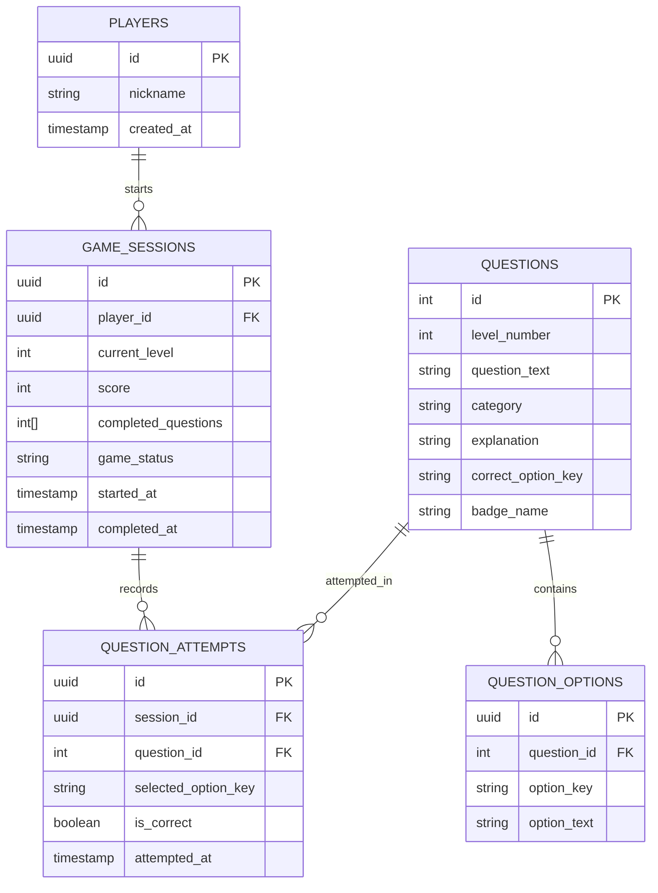

# PRODUCT ODYSSEY: JUMP. THINK. BUILD. BECOME A PM.

> **Tagline:** JUMP. THINK. BUILD. BECOME A PM.  
> **Supporting line:** Collect coins. Crack product challenges. Reach the castle. Get hired.

A complete, responsive, colorful 2D platform-adventure game built with **Next.js 14**, **React**, **TypeScript**, **Tailwind CSS**, procedural vector canvas animation, Web Audio synthesis, and RESTful API backend routes.

---

## 🌟 Core Gameplay Flow

```
HOME SCREEN ──► LEVEL 1: THE PRODUCT APPRENTICE (5 PM MCQs) ──► LEVEL COMPLETE (+200 PTS) ──►
LEVEL 2: THE PRODUCT CHAMPION (5 PM MCQs) ──► CASTLE GATES OPEN (+500 PTS) ──►
APM JOB OFFER & VICTORY SCREEN
```

1. **Character**: **Pico, the Product Explorer**, an adorable young adventurer with an explorer vest, backpack, product-themed badge, cap, and sneakers. Has responsive animations for idle breathing, running, jumping, spring launching, question contemplation, and victory celebrations.
2. **Platforming Mechanics**: Smooth 60 FPS physics engine featuring gravity, variable jumping, horizontal inertia, floating platforms, oscillating moving platforms, bouncy spring mushrooms, and pit respawning at checkpoints.
3. **Interview Checkpoints**: Exactly 10 golden interview coins scattered at distinct checkpoints (5 in Level 1, 5 in Level 2). Colliding with a coin pauses the game world and presents the MCQ modal.
4. **Scoring**:
   - Standard Gold Coin: **+10 PTS**
   - Correct PM Answer: **+100 PTS** (awarded only once per question)
   - Level 1 Completion: **+200 PTS**
   - Level 2 Completion: **+200 PTS**
   - Castle Victory: **+300 PTS**
5. **No Softlocks**: Unlimited retries with detailed PM rationales; questions cannot be skipped or double-awarded.
6. **Final Castle & APM Offer**: Royal throne room ceremony with recruiter greeting, custom-addressed APM Job Offer letter, candidate performance scorecard, and printable achievement certificate.

---

## 🎮 Controls

### Desktop
- **A / Left Arrow**: Move Left
- **D / Right Arrow**: Move Right
- **Space / W / Up Arrow**: Jump
- **Esc**: Pause / Resume Menu
- **A, B, C, D**: Choose Answer in MCQ Modal

### Mobile / Touch
- On-screen touch buttons for **LEFT**, **RIGHT**, and **JUMP**.

---

## 🏗️ Technical Architecture & Database ER Diagram

### Database Schema (Supabase PostgreSQL / Relational Schema)



---

## 🚀 Suggested REST API Endpoints

- `GET /api/health` — System status and version
- `POST /api/sessions` — Start new player game session
- `GET /api/sessions/:sessionId` — Fetch live session state
- `POST /api/sessions/:sessionId/answer` — Validate MCQ submission and award points
- `POST /api/sessions/:sessionId/complete-level` — Validate all questions cleared and award level bonus
- `GET /api/sessions/:sessionId/report` — Generate candidate APM scorecard and question breakdown

---

## 🛠️ Running Locally

```bash
# 1. Install dependencies
npm install

# 2. Build for production
npm run build

# 3. Start production server
npm run start
# Server starts on http://localhost:3005
```
